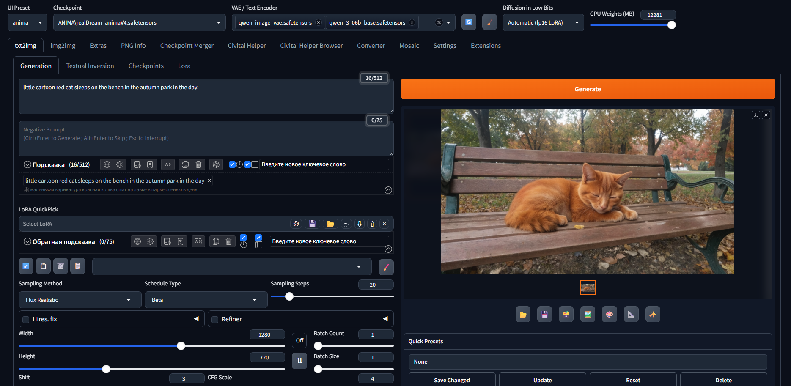

# Forge GPU Weights per Preset

A small extension for **Stable Diffusion WebUI Forge Neo** that restores the old-style **GPU Weights (MB)** control and stores a separate GPU allocation for each UI preset.



## Features

- Adds **GPU Weights (MB)** back to the top checkpoint/preset bar.
- Stores an independent value for every Forge Neo UI preset.
- Automatically applies the saved GPU weight when switching presets.
- Adds a **GPU Weights per Preset** section in Settings.
- Converts MB values to Forge Neo's current `setting_allocated_vram` ratio internally.
- Does **not** modify Forge core files.

## Why

Older Forge builds exposed GPU Weights directly in the main UI and allowed different values for different presets. Forge Neo moved this to a single global setting. This extension restores per-preset behavior while keeping Forge Neo itself untouched.

## Installation

### ZIP

1. Download this repository as ZIP.
2. Extract the folder to:

   `Forge Neo/extensions/forge-gpu-weights-per-preset`

3. Restart Forge Neo completely.

### Git

Clone the repository directly into the `extensions` folder:

```bash
cd /path/to/Forge-Neo/extensions
git clone https://github.com/YOUR_USERNAME/forge-gpu-weights-per-preset.git
```

Then restart Forge Neo.

## Usage

After startup, a new **GPU Weights (MB)** slider appears in the top model controls.

Each UI preset gets its own saved value. For example:

- SD: 10000 MB
- XL: 12000 MB
- FLUX: 14000 MB
- QWEN: 11000 MB

Switching UI Preset automatically loads and applies the corresponding value.

You can also edit the defaults in:

**Settings → UI → GPU Weights per Preset**

## Startup message

When loaded successfully, Forge prints a line similar to:

```text
[Forge Neo] GPU Weights per Preset v1.0.0 loaded (VRAM detected: 16376 MB)
```

## Compatibility

Designed for **Forge Neo** and tested with the Neo codebase where:

- `modules_forge.main_entry.make_checkpoint_manager_ui` exists;
- preset switching uses `modules_forge.main_entry._load_presets`;
- GPU allocation is stored in `setting_allocated_vram`.

Forge Neo changes may require future compatibility updates.

## Uninstall

Delete:

`extensions/forge-gpu-weights-per-preset`

Then restart Forge Neo. Existing per-preset values may remain in Forge's config file but are harmless.

## License

AGPL-3.0. See [LICENSE](LICENSE).

## Credits

Built for the Forge Neo workflow and inspired by the per-preset GPU Weights behavior available in older Forge builds.

Forge Neo is developed separately and is not bundled with this extension.
