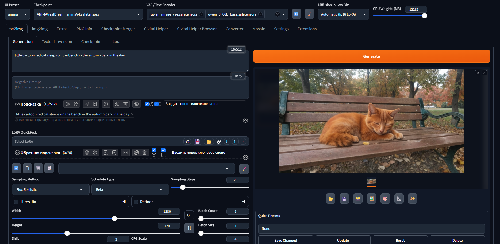

# Forge GPU Weights per Preset

Небольшое расширение для **Stable Diffusion WebUI Forge Neo**, которое возвращает регулятор **GPU Weights (MB)** на главную панель и позволяет хранить отдельное значение для каждого UI Preset.



## Возможности

- Возвращает **GPU Weights (MB)** в верхнюю панель.
- Хранит отдельное значение для каждого UI Preset.
- Автоматически применяет нужное значение при переключении пресета.
- Добавляет раздел **GPU Weights per Preset** в Settings.
- Внутри переводит MB в используемый Forge Neo параметр `setting_allocated_vram`.
- Не изменяет файлы ядра Forge.

## Установка

Распакуйте папку репозитория в:

`Forge Neo/extensions/forge-gpu-weights-per-preset`

После этого полностью перезапустите Forge Neo.

При успешной загрузке в консоли появится примерно:

```text
[Forge Neo] GPU Weights per Preset v1.0.0 loaded (VRAM detected: 16376 MB)
```

## Использование

На верхней панели появится слайдер **GPU Weights (MB)**.

Для каждого пресета можно задать своё значение. При переключении UI Preset расширение автоматически загрузит и применит его GPU Weights.

Значения также доступны в:

**Settings → UI → GPU Weights per Preset**

## Удаление

Удалите папку:

`extensions/forge-gpu-weights-per-preset`

и перезапустите Forge.

## Лицензия

AGPL-3.0. См. [LICENSE](LICENSE).
